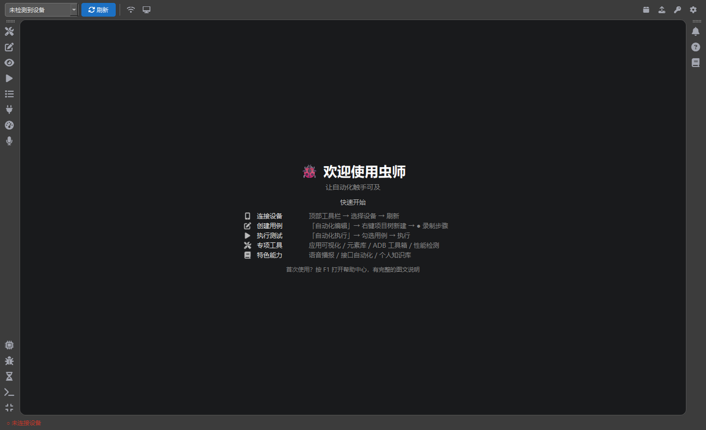
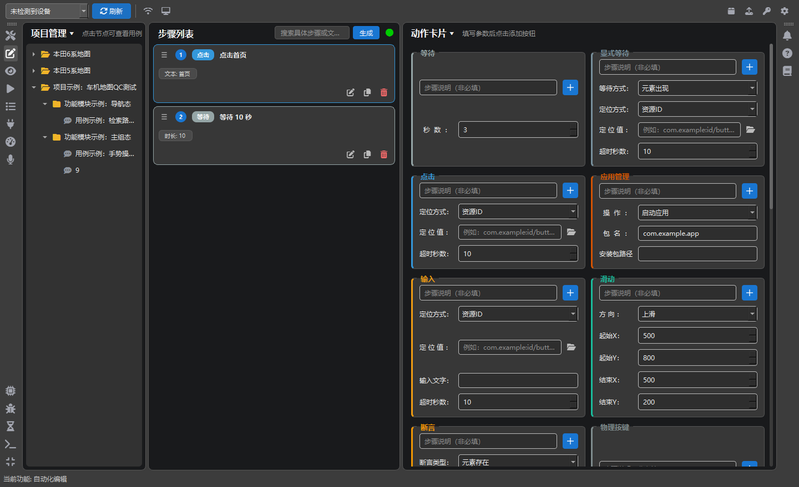
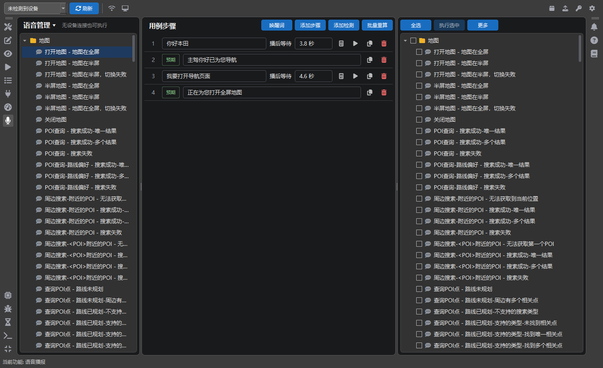
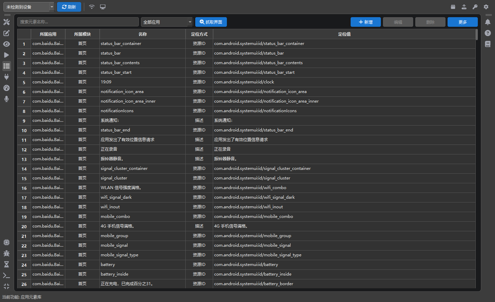
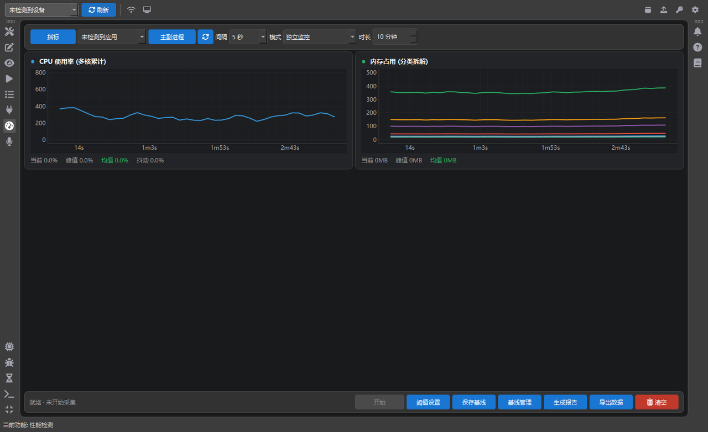

# 虫师（Chongshi）

> Android 自动化测试，一个工具就够了。

**虫师**是一套跑在 Windows 桌面上的 Android 自动化测试工具，面向**车机与手机 App**：不用写代码，
在图形界面里就能搭起「编用例 → 管元素 → 跑执行 → 看报告」的完整闭环；平时反复手敲的 ADB 操作
（截图、日志、Monkey、弱网、抓包、堆转储、性能采集）也都收在同一个工具箱里。

一句话概括：**让没有脚本基础的人也能做自动化，让有脚本基础的人不用再写脚本。**

| 项目 | 说明 |
|---|---|
| 当前版本 | **1.5.24**（预发布；公开最新稳定版 **1.5.23**）。`utils/version.py` 是唯一版本号来源 |
| 平台 | Windows 10 / 11 x64，绿色免安装 |
| 技术栈 | Python 3.13 + PyQt6（含 QtWebEngine）+ uiautomator2 + adb |
| 代码规模 | 139 个 Python 文件，约 7.1 万行（views 34.1k / utils 10.2k / services 9.6k / controllers 7.1k / models 4.1k） |
| 安装包 | zip 约 440 MB，解压后程序约 890 MB（另含 `data/` 用户数据；内置 scrcpy / tcpdump / weditor.exe，**不含 adb**） |
| 发布通道 | GitHub Releases：正式版走 `/releases/latest`，预发布即灰度通道（见 5.9） |
| 许可 | MIT |

---

## 关于这份文档

这份 README 不是营销页，而是**功能全景 + 实现现状**的说明书，目标读者包括「想了解能力边界的使用者」
和「要基于现状做优化分析的人（含 AI）」。为了让信息不过时，约定如下：

- **版本锚点**：本文对应 **1.5.24**，最后一次逐项核对代码是 **2026-11-13**。
  1.5.24 已在本日作为**预发布**发布（`/releases/latest` 仍指向稳定版 1.5.23），
  因此普通客户端「检查更新」还看不到这批能力；本文按 1.5.24 的代码状态描述。
- **标注约定**：✅ 已实现且已接入界面；⚠️ 代码写好但界面未接线；❌ 未实现/仅方案。
- **代码位置**用 `路径:类.方法` 形式标出，方便直接对照源码核实；**文档与代码冲突时以代码为准**。
- 每次改动的「用户视角说明」记在 `CHANGELOG.md`，本文只描述**当前状态**，不记流水账。
- 已知缺口、坑、未接线项集中在第 7、8 章，请不要只读第 4 章功能列表就下结论。

**目录**：[0 关于本文档](#关于这份文档) · [1 它是什么](#1-它是什么) · [2 快速开始](#2-快速开始) ·
[3 界面总览](#3-界面总览) · [4 功能详解](#4-功能详解) · [5 技术架构](#5-技术架构) ·
[6 关键实现细节](#6-关键实现细节做优化分析必读) · [7 已知限制](#7-已知限制诚实清单) ·
[8 规划中](#8-规划中) · [9 开发约定](#9-开发约定) · [10 常见问题](#10-常见问题) ·
[11 版本历史](#11-版本历史) · [12 许可证](#12-许可证)

---

## 1. 它是什么

### 1.1 解决什么问题

Android 自动化测试工具链长期存在三个断层：

1. **工具碎**：定位元素用 uiautomatorviewer / weditor，跑用例用 Appium / uiautomator 脚本，
   抓包用 tcpdump，看性能用 PerfDog / atrace，每个工具一套概念。
2. **门槛高**：写脚本要懂 Python、懂 selector、懂等待策略，测试同学往往卡在「等元素」上。
3. **车机场景缺位**：车机分辨率、朝向、系统签名、日志路径、无 root、多屏，和手机差别很大，
   通用工具经常「能连上但点不准」。

虫师的做法是**把整条链收进一个桌面应用**，并且专门针对车机做了兼容（横屏坐标、物理像素、
多触摸设备、受限系统的 Monkey 启动方式等）。

### 1.2 设计取舍（有意为之的部分）

- **用例 = 卡片**：一张卡片就是一个步骤，参数用表单填，不写代码；卡片可拖拽排序。
- **设备侧只用 uiautomator2 + adb**：不依赖 root，不注入进程，不要求被测 App 改造。
- **坐标永远留一手**：所有语义定位（资源 ID / 文本 / 描述）都同时存归一化坐标，
  语义失效时还能按比例点回去。
- **宁可多等，不要误判**：元素等待有总预算、点击后有生效校验（见 6.3、6.4）。
- **数据全在本地**：`data/` 目录随程序走，不依赖数据库、不联网也能跑。
- **单进程单实例**：用命名互斥量 `Local\ChongshiSingleInstance` 保证只跑一个（`main.py:__main__`），
  启动时最多重试 3 秒；判定「已有实例」还会校验窗口类与窗口所属进程，排除资源管理器等同名窗口误判，
  结果写入 `%TEMP%\chongshi_single_instance.log`，避免两个实例抢 adb。

---

## 2. 快速开始

### 2.1 直接使用（推荐）

1. 到 [Releases](https://github.com/amosli0806/AndroidAutoTest/releases/latest) 下载 `chongshi-<版本>-win64.zip`
   （`latest` 是当前稳定版 **1.5.23**；1.5.24 为预发布，只在 Release 列表里、普通更新链路不可见）
2. 解压到任意目录（**路径含中文没问题**），双击 `虫师.exe`
3. 手机/车机打开 **USB 调试**，插线后顶部工具栏会出现序列号
4. `F1` 打开帮助中心，里面有每一步的图文说明

升级有两种方式：应用内「菜单 → 检查更新」自动下载替换（优先增量补丁）；
或手动下载新包解压覆盖，**`data/` 目录不会被覆盖**。

### 2.2 从源码运行

```bash
pip install -r requirements.txt
python main.py
```

需要 **Python 3.13**；`tools/` 里已内置 **scrcpy / tcpdump**，adb 需自行安装 platform-tools 并加入 PATH
（`utils/adb_path.py:adb_installed` 会在启动时检查，缺失只警告不阻断）。

### 2.3 打包

```bash
pyinstaller weditor.spec --noconfirm --distpath dist_weditor   # 先打 weditor（应用可视化依赖）
pyinstaller main.spec --noconfirm                              # -> dist/虫师/（onedir）
pyinstaller updater.spec --noconfirm --distpath dist_updater --workpath build_updater
                                                               # -> dist_updater/updater.exe（onefile，约 7 MB）
```

---

## 3. 界面总览

主窗口是「左栏功能导航 + 右栏整页入口 + 顶部工具栏 + 底部面板」的结构（`views/main_window.py`）。

**左栏 7 个功能页**（`nav_items`，页面在 `QStackedWidget` 里，索引见 `nav_indices`）：

| 页面 | 职责 | 代码 |
|---|---|---|
| **ADB 工具箱** | 命令执行台 + 12 条预设命令 + 弱网 / Monkey 面板 | `views/adb_toolbox_view.py` |
| **自动化编辑** | 项目树 + 步骤列表 + 动作卡片（三栏），支持录制与自然语言生成 | `views/project_tree_view.py` / `step_list_view.py` / `action_card_view.py` |
| **自动化执行** | 勾选用例 → 执行 → 日志（在底部面板）→ 报告 | `views/execute_view.py` |
| **应用元素库** | 元素集中管理 + 一键验证 + 抓取界面 + 拾取入库 | `views/element_manager_view.py` |
| **接口自动化** | 分组/接口 + 环境变量 + 断言 + 批量执行 + 报告 | `views/api_view.py` |
| **性能检测** | CPU/内存/FPS/流量采集 + 整机探针 + 现场留证 + 报告 | `views/perf_view.py` |
| **语音播报** | 语音用例库 + TTS 播报 + logcat 回执验证 | `views/voice_view.py` |

底部左栏有 6 个开关：硬件信息 / Crash 日志 / ANR 日志 / **执行日志** / 虫师日志（`Ctrl+L`）/ 迷你模式。

**右栏 4 个入口**：消息中心（铃铛，带未读角标）、**应用可视化**（开关 weditor 浮窗，不占整页）、
帮助中心（`F1`）、个人知识库。另有「欢迎页」（`QStackedWidget` index 6）作起始页。

顶部工具栏：设备下拉 + 刷新 + 无线联调 + 投屏 + 安装 APK + 推送文件 + MD5 + 齿轮菜单（设置/检查更新/关于）。

左右两栏都用 `_lock_toolbar_in_place()` 固定：不能拖动换边、不能拖成浮动窗口，
右键也不会弹出「显示/隐藏工具栏」菜单（那个菜单一旦把左栏勾掉就没有恢复入口）。

底部面板 6 种互斥内容：虫师日志 / **执行日志** / 硬件信息 / Crash 日志 / ANR 日志 / 消息中心，
占主分割器 30%（`BOTTOM_PANEL_RATIO`），虫师日志不限行数。左栏底部各有开关，再点一次收起。

**迷你模式**：设计尺寸 500×620（`views/main_window.py:MINI_WINDOW_SIZE`），只保留 ADB 指令管理区，
适合边看设备边敲命令。顶栏保留「设备下拉 + 刷新 + 无线联调 + 投屏 + 安装 APK + 推送文件」，
左栏只留底部 5 个开关（执行日志按钮在此模式下隐藏）。

### 界面截图

主界面 —— 左侧 7 个功能页，右侧工具栏依次是消息、应用可视化、帮助中心、个人知识库：



**自动化编辑** —— 左：项目树；中：步骤卡片，可拖拽排序；右：动作卡片库，填好参数点「+」即可加进步骤



**语音播报** —— 播报行与检测行交替排列，播完抓 logcat 判定车机是否真的响应



**应用元素库** —— 元素按应用 / 模块归类，六种定位方式，支持一键在设备上验证



**性能检测** —— CPU / 内存实时曲线，采集结束自动出报告



> 截图里的项目名、元素与本地路径均为演示数据。自行补图请注意：界面会直接显示设备序列号、
> 包名、日志内容，公开仓库的截图前请先确认没有内部项目代号与客户包名。

---

## 4. 功能详解

### 4.1 自动化编辑

三栏：左「项目管理」（项目树）/ 中「步骤列表」/ 右「动作卡片库」。

#### 4.1.1 项目树（四级）

`project`（项目）→ `folder`（功能模块）→ `case`（用例）→ 步骤，节点类型定义在
`models/project_model.py:TreeNode`，持久化到 `project_data.json`（**顶层是数组**，递归含 children）。

- 右键菜单：空白处「创建项目」；项目上「创建功能模块 / 复制项目」；模块上「创建用例 / 复制功能模块」；
  用例上「复制用例 / 绑定数据文件… / 清除数据绑定」；所有类型「重命名 / 删除」
- 多选用例时只给「删除选中的 N 个用例」
- 复制命名自动加「副本 / 副本N」
- **删除会级联清理**：子用例的步骤与套件引用一并删除（`controllers/project_controller.py:110`），
  历史上漏这一步导致 `steps_data.json` 里堆满孤儿步骤
- 节点 id 规则 `{type}_{毫秒时间戳}_{自增:04d}`；早期用 `id(name)`（内存地址）导致节点撞 id，
  启动时会 `repair_duplicate_ids()` 自愈（`main.py:616`）

#### 4.1.2 步骤列表

`views/step_list_view.py`。每张卡片显示：序号圆点 + 类型彩色徽章 + 名称 + 参数 chip（最多 4 个）+ 三个操作按钮（编辑 / 复制 / 删除）。

- **拖拽排序**：`InternalMove`，拖拽手柄在卡片左侧；**多选时禁止拖拽**（避免误排序）
- **多选**：`Ctrl/Shift` 点选、`Ctrl+A`；`Delete/Backspace` 批量删除
- **右键**：「批量修改参数（N 个步骤）…」/「删除此步骤」
- **过滤**：按步骤名、类型中文名、参数值模糊搜索
- 标题行右侧有两个按钮：**✨ 生成**（自然语言转步骤，随搜索框内容启用/禁用）、
  **● 录制**（绿点/红点，录制中脉冲闪烁）

#### 4.1.3 动作卡片（17 种）

定义在 `views/action_card_view.py`（表单字段）与 `services/device_service.py:_perform_*`（执行实现）。
每张卡片顶部都有「步骤说明（非必填）」和蓝色「+」添加按钮；定位类字段（定位值 / 起点 / 终点）右侧
固定有两个小按钮：「选元素」（📁，从元素库挑一条回填）和定位辅助按钮（按定位方式自适应，见下）。

| # | 卡片 | type | 参数（默认值 / 范围） |
|---|---|---|---|
| 1 | 等待 | `wait` | 秒数（默认 3，必填） |
| 2 | 显式等待 | `wait_for` | 等待方式［元素出现 / 元素消失 / 元素可点击］、定位方式、定位值、超时 10s |
| 3 | 点击 | `click` | 定位方式、定位值（必填）、超时 10s |
| 4 | 应用管理 | `app_mgr` | 操作［启动 / 停止 / 重启 / 清空数据 / 安装 / 卸载］、包名（必填）、安装包路径 |
| 5 | 输入 | `input` | 定位方式、定位值（必填）、输入文字（必填）、超时 10s |
| 6 | 滑动 | `swipe` | 方向［上滑 / 下滑 / 左滑 / 右滑 / 自定义坐标］、起止 XY（默认 500,800 → 500,200） |
| 7 | 断言 | `assert` | 断言类型［元素存在 / 元素不存在 / 文本等于 / 文本包含］、定位方式、定位值、预期值、超时 5s |
| 8 | 物理按键 | `physical_key` | 按键［返回 / 主页 / 菜单 / 音量+ / 音量- / 电源 / 相机］ |
| 9 | 屏幕控制 | `screen_ctrl` | 操作［唤醒 / 熄灭 / 旋转 / 固定竖屏 / 固定横屏］ |
| 10 | 长按 | `long_press` | 定位方式、定位值、长按毫秒（默认 1000）、超时 10s |
| 11 | 飞掠 | `flick` | 方向［上 / 下 / 左 / 右］、距离像素 300、速度 3000 px/s |
| 12 | 双击 | `double_click` | 定位方式、定位值、超时 10s（实现为两次点击间隔 50ms） |
| 13 | 多点滑动 | `multi_swipe` | 路径点（默认 `100,1000;500,1000;900,1000`，必填）、时长毫秒 1000 |
| 14 | 拖拽 | `drag_drop` | 起点方式 / 起点值 / 终点方式 / 终点值（定位方式 5 种，无「图像」） |
| 15 | 手势（捏合/放大） | `gesture_zoom` | 手势类型［捏合（缩小）/ 放大］、中心点（默认 540,960）、缩放比例（0.1~100，默认 1.5） |
| 16 | 截图 | `screenshot` | 保存路径（默认设置里的输出目录）、文件名前缀（默认 screenshot） |
| 17 | 语音播报 | `voice` | 播报文案（默认设置里的唤醒词，必填）、播后等待（默认 2.0s，旁有「估算」按钮） |

卡片可显隐（「动作卡片 ▾」勾选，持久化到 `config.json` 的 `visible_action_cards`），隐藏后参数仍保留。

定位值右侧的**定位辅助按钮按当前定位方式换身份**：定位方式=图像时是相机（截屏框选，生成模板图），
其余五种是准星（打开拾取面板，在设备画面上点控件，自动回填定位方式与定位值，同 ID 多节点带 `instance`）。
两类动作语义互斥，所以只占一个固定位置，不会把输入框挤窄；图标本身已说明动作，不再挂悬停提示。
细节见 4.1.7；手机（抖音页面）与车机（Honda 3QK）双端均已实测通过。

#### 4.1.4 定位方式与回退链

六种：**资源 ID / 文本 / 描述 / XPath / 坐标 / 图像**（`utils/step_params.py:LOCATION_TYPE_OPTIONS`）。

执行期的定位顺序（`services/device_service.py`）：

1. **元素库解析**：步骤带 `element_id` 时，用元素库里的 `loc_type/loc_value` **覆盖**步骤参数，
   元素库改了不用改用例（`controllers/element_controller.py:resolve_element`）
2. **变量替换**：解析后再替换 `${变量}`（顺序不能反，元素库的定位值里也可能写变量）
3. **浅层快查**：资源 ID / 文本 / 描述先做一次限深 16 层的 dump，本地解析 bounds 直接算坐标点
   （见 6.1；完整 dump 在大页面要 8~12 秒，Honda 3QK 车机页面实测 0.3~0.6 秒）
4. **完整定位**：快查未命中才用 uiautomator2 原生 selector
5. **坐标兜底**：所有语义定位失败时按归一化坐标点击；资源 ID 有重复时带 `instance` 序号，
   录制生成的步骤还会带 `fallbackType/fallbackValue`（文本兜底）

图像定位用 OpenCV `matchTemplate`（`TM_CCOEFF_NORMED`，单尺度，阈值默认 0.8，
`utils/image_match.py`），支持中文路径。

#### 4.1.5 录制回放 ✅

在设备上正常操作一遍，直接生成动作卡片（`controllers/step_controller.py`）。

流程：选中用例 → 点步骤列表上方圆点开始录（变红 + 脉冲）→ 操作设备 → 再点一次停止。

- 底层读 `adb shell getevent -t <触摸设备>`，**不轮询截图**，所以能识别真实手势
- 触摸设备自动探测（`getevent -p`），多屏车机会弹窗让你选；量程比例异常时打印警告
- 手势判定：位移 < 80px 判 tap，否则 swipe（记录四方向）；两次 tap 间隔 < 0.4s 且位移 < 80px 合并为双击；
  按下 ≥ 0.8s 判长按（记录实际毫秒）
- **输入步骤**：点击落在输入框（className 含 EditText / AutoCompleteTextView / SearchView）且框内有文字时，
  升级为「输入」卡片 —— 触摸事件拿不到字符，靠停录后额外 dump 一次取最终文本
- **定位反查**（可选）：停录时询问「是否自动反查控件」。反查会为每个点击点 dump 一次层级，
  按 **资源 ID > 文本（≤60 字）> 描述 > 坐标** 生成定位，资源 ID 重复时统计同窗口内的实例序号，
  并额外写入文本作为 `fallback`。不反查则只生成坐标步骤，速度快。
  反查的命中判定已抽到 `utils/ui_tree.py`（`find_node_at` / `locator_for`），元素拾取器（4.1.7）
  用的是同一份规则 —— 两处行为不会出现「录制点得准、拾取点偏了」这种分裂。
- **异步 dump**：down 时不立即 dump（会 dump 到切换前的旧界面），而是把 `(时间, x, y)` 投进队列，
  由后台线程在 up 之后、页面稳定时执行（队列空时多等 0.35s）
- **预览确认**：生成前弹「录制完成」清单，逐条勾选保留哪些，落在系统栏/系统窗口上的标 ⚠ 系统 UI
- 坐标同时存归一化值与录制时的屏幕尺寸、朝向（横屏录制也能正确回放，见 6.2）

#### 4.1.6 自然语言生成步骤 ✅

搜索框输入一句话，点「✨ 生成」即可拼出步骤（`controllers/step_controller.py:generate_steps_from_text`）。
这是**规则实现，不调用大模型**：

- 分句：按 `然后 / 接着 / 再 / 之后 / 随后 / 并` 和 `。；\n，` 切分
- 动作词表（按顺序匹配）：点击/单击、双击、长按、输入/键入、等待/暂停、滑动/上滑/下滑/左滑/右滑/划动、
  拖拽/拖动、缩小/放大、启动/打开/运行、返回/主页/菜单、截图、断言/验证/判断/检查
- 元素匹配：先用「元素名整体出现在句子里」精确命中；否则删掉动作词后分词，过停用词表，
  按包含关系打分取名字最短的元素
- 参数模板：点击依次取「匹配到的元素 > 引号内文本 > 去掉动词后的剩余文本」；输入用三级正则取要输入的文字；
  等待取 `N 秒`（缺省 3 秒）；断言按「不存在 / 等于 / 包含 / 为」判类型
- 后处理：相邻的「点击 + 输入」会自动合并成一条「输入」卡片

#### 4.1.7 从画面拾取定位（元素拾取器）✅

`views/dialogs/element_pick_dialog.py` + `utils/ui_tree.py`。目标：不必再「开 weditor → 点控件 →
复制 selector → 回卡片粘贴」。

- **入口**：动作卡片定位值右侧的定位辅助按钮（准星 / 相机，见 4.1.3）；
  元素库的「创建/编辑元素」对话框用的也是同一套
- **加载过程**：面板先以 420×260 的紧凑窗显示「正在读取设备画面…」+ 不确定进度条；截图 + dump 完成后
  一次性换成完整画面，避免「先弹一个空的大窗、再突然缩小」的跳动。画面按屏幕可用区限制尺寸并重新居中
  （只 `resize()` 会保持左上角不动，曾导致窗口向右下长、超出屏幕）
- **一次 dump**：打开面板时截图 + 读层级各一次并缓存；之后每次点击都在本地 XML 里命中，
  **不再 dump**（dump 耗时与页面规模强相关：大页面 8~12 秒，Honda 3QK 实测 0.3~0.6 秒，
  但都不能每点一次都来一遍）。换页面点「刷新」重新截图 + dump 一次
- **命中规则**（`ui_tree.find_node_at`，与录制反查共用同一份）：收集所有 bounds 覆盖该点的节点
  （祖先与后代都算）→ 有资源 ID / 文案 / 描述的优先 → 按「可点击 > 有文案 > 仅资源 ID」分档，
  同档取面积最小 → 带资源 ID 时统计**同一窗口内**的同 ID 数量与序号。全无属性时（游戏 / Flutter）
  仍兜底返回一个节点，由调用方退化成坐标，并在预览条写明「已按坐标定位」
- **回填**：定位方式按 资源 ID > 文本（≤60 字）> 描述 > 坐标 选一个；同 ID 多节点自动算 `instance`
  序号（预览条显示「同 ID 共 N 个（第 K 个）」），提交卡片时写进 `params["instance"]`
- **解除元素绑定**：拾取到的值不再是元素库里那条记录，回填时会清掉控件的 `element_id`，
  否则提交时会被元素库的旧定位覆盖
- **防连点**：刷新期间按钮置灰 + `_loading` 重入标志 + 加载遮罩。因为截图与 dump 都阻塞主线程，
  置灰前要先 `repaint()` + `processEvents()` 才画得出来；而点击事件会排队，光置灰挡不住第二次
- **顺手入库**：从动作卡片拾取时，面板底部可勾「同时存入元素库」，勾上即展开三行——
  应用默认当前包名、模块默认「默认」、名称按资源 ID 末段 / 文本预填；入库走
  `ElementModel.upsert_elements`，合并键是 **应用 + 模块 + 名称**（与 Excel 导入同一套；
  「抓取界面」则按「应用 + 模块 + 定位方式 + 定位值」跳过重复项）
- **双端验收**：手机（抖音页 `btn_immersefullscreen` / `treasure_loading_view`）与车机（Honda 3QK）已实测通过
- **边界**：dump 失败只能退回「截屏取图」或手填；自绘界面（游戏 / Flutter）层级里 `clickable=false`，
  只能给坐标；重叠图层（弹窗遮罩）按「可点优先 + 同档面积最小」命中，个别场景需要真机抽验

---

### 4.2 自动化执行

#### 4.2.1 界面

`views/execute_view.py`：三栏 = 左「用例树（可勾选，三态联动）」/ 中「执行区（工具栏 + 套件）」/ 右「定时计划」。

执行日志**不占执行页**：它是主窗口底部面板的一种（左栏底部「执行日志」开关，再点收起），
收起后执行页能把整块高度给用例树与执行区；点「执行」时若面板收着会自动展开一次。

它只放**用例执行过程**（步骤开始 / 通过 / 失败、断言结果、失败原因）。性能检测的事件
（连接中断、堆转储、报告已保存…）只写「虫师日志」，否则会把正在跑的步骤刷掉；
场景化执行时的「第几条用例」这类进度仍会转发进来。

工具栏单行：`全选/取消全选`、`执行/停止`（蓝→红）、`套件` 下拉（右键可编辑内容与执行顺序）、
`保存套件`、`删除套件`、`测试报告`、`更多 ▾`。

「更多 ▾」里是执行策略：**循环次数**（1~999，默认 1）、**失败停止**、**失败重试**（0~5，默认 1，0 = 不重试）、
**重试间隔**（0~30s，默认 2）、**重试触发条件**（仅超时类 / 所有失败）。

#### 4.2.2 执行时序

`controllers/execution_controller.py:ExecutionWorker.run`，跑在 `QThread` 里：

```
for loop in 1..循环次数:
    for 每个勾选的用例:
        若绑定数据文件 → 逐行跑（只在第 1 轮），每行前 set_row_values(row)
            for 每个步骤:
                next_step = 下一步
                device_service.perform(step, next_step)  ← 失败则按配置重试
                打印日志 / 累计统计
            步骤失败 → 跳出该用例；用例失败 → 下一用例；失败停止 → 全部终止
```

要点：

- **步骤间隔**由「设置 → 自动化步骤间隔」控制（0~5s，默认 2s）。若**本步或下一步**是
  `wait / wait_for / voice`（自带等待语义），本步结束后不再叠加间隔，避免同一段时间算两遍
  （`services/device_service.py:239`）。车机 4 步导航用例实测：间隔 2s → 14.83s，1s → 10.40s，
  0s → 7.00s，可按设备响应速度折中
- **重试**只重试当前步骤，`_should_retry` 在「仅超时类」模式下只认错误文本里的「超时 / timeout」
- **停止**是置 bool + 步骤边界检查，不会强杀正在超时等待的步骤（所以点停止要等当前步骤跑完）
- **统计不靠回调**，而是解析日志文本（`success` 且含「执行通过」→ 通过数 +1），口径单一但脆
- **数据驱动**：绑定了 CSV/XLSX 的用例，表头即变量名，每行跑一遍；数据文件缺失按该用例失败处理
- 未连接设备且用例含需要设备的步骤时直接拒绝执行，并用前 3 个步骤名说明原因；只有语音/等待类步骤时允许跑

#### 4.2.3 报告与留证

- HTML 报告落在 `<输出目录>/<设备序列号>/TestReport_<时间戳>.html`（`utils/report_generator.py`）
- 报告内容：标题 + 生成时间、三张统计卡（通过 / 失败 / 通过率）、执行日志滚动区；
  **失败步骤的截图以 base64 内嵌**在日志行里
- 报告无 JS、无外链，单文件可直接发出去
- 执行失败时把「上一步到失败前」的步骤快照、错误信息、截图路径收进 `FailureContext`，
  供日志页的「✨ AI 分析失败」使用

---

### 4.3 应用元素库

`views/element_manager_view.py`，数据在 `elements_data.json`。

- 表格 6 列：所属应用 / 所属模块 / 名称 / 定位方式 / 定位值 / **状态**；备注不占列，
  在新增 / 编辑对话框和 Excel 里维护
- 操作：搜索、按应用筛选、**抓取界面**、**检查引用**、创建 / 编辑 / 删除、导入 / 导出（Excel）
- **批量校验**（多选 → 右键「验证选中的 N 个（一次读屏）」）：一次 `dump_ui_xml()` 后在本地匹配，
  结果写进「状态」列（✅ 存在 / ❌ 不存在 / — 未校验）。之所以不逐个调 `exists()`：
  u2 的 exists 每次都要 dump，车机单次 8~12 秒，20 个元素就是几分钟；本地匹配仍是 1 次开销。
  资源 ID / 文本 / 描述可本地判定；XPath（ElementTree 语法有限）与坐标、图像一律标「未校验」
- **重新拾取定位**（单选 → 右键）：打开拾取面板点一下控件，只更新该元素的定位方式与值，
  id / 名称 / 应用 / 模块都不变（步骤里的 `element_id` 引用因此依然有效）
- **检查引用**（顶部按钮）：扫描全部用例步骤，列出 `element_id` 指向「已不存在的元素」的死引用，
  形如「用例 / 步骤 / 缺失的元素 / 现有定位」。这类步骤执行时 `resolve_element()` 会直接抛
  「元素ID 已失效」，所以给了两条修复路径：**重新拾取**（写回新定位并解除死引用）与
  **解除引用**（只抹掉 `element_id`，保留步骤原有的定位方式与值）；也可一键「全部解除引用」。
  这一步只读 `steps_data.json` + `elements_data.json`，不需要连设备
- **抓取界面**：一次 dump 当前屏幕，列出所有可定位元素（默认勾选「可点击 / 有文案」的，
  纯布局容器不勾），统一填应用与模块后批量入库；已存在项按「应用 + 模块 + 定位方式 + 定位值」跳过
- Excel 格式：**一个应用一张工作表**，5 列（所属模块 / 名称 / 定位方式 / 定位值 / 备注）；
  导入是「新增 + 覆盖」不删除，合并键是「工作表（应用）+ 所属模块 + 名称」，命中时保留原 id
  （否则步骤里的 `element_id` 引用会失效）
- 删元素只删除元素库记录，**不会自动清理步骤里的 `element_id`**：引用它的步骤会显示「已失效」，
  执行时报「元素ID已失效」。删除确认框已如实说明这一点，并提示去「检查引用」统一修复

---

### 4.4 应用可视化（weditor）

`services/weditor_service.py`：在 `localhost:17310` 起 weditor 服务，用 `QWebEngineView` 内嵌到浮动 Dock。
**不是独立工具**，在虫师里就能看画面 + UI 层级树 + 复制 selector。

入口是**右栏的「应用可视化」按钮**（位于消息中心与帮助中心之间）：它是**开关**而不是「占一整页」，
点一下弹出浮窗、再点一下收起；用户用浮窗自己的 × 关掉时按钮会自动取消选中（`visibilityChanged` 回同步）。
迷你模式下该按钮隐藏（浮窗设计宽度 1180，迷你窗口只有 500 宽，放不下）。

- 首次打开自动启动服务（端口轮询 0.2s，上限 15s），关闭 Dock 不退出进程，程序退出时清理
- 打包版用 `_internal/tools/weditor.exe`，源码模式用 `python -m weditor`
- 两个启动期源码补丁：修正 weditor 0.7.3 在 Python 3.13 下的 `pkg_resources` 失效问题；
  给 ipyshell 的 `Popen` 补 `CREATE_NO_WINDOW`（否则每次查询弹黑框）
- 进程治理：Job Object（父死子亡）+ `aboutToQuit` + `atexit` 三重兜底
- 已知限制：weditor 的 selector 仍需手动复制；卡片里可直接用定位值旁的准星从画面拾取（见 4.1.3）

---

### 4.5 接口自动化

`views/api_view.py` + `services/api_service.py`，数据在 `api_data.json`。**纯 HTTP，不依赖设备**。

三栏：左「接口管理 ▾」（分组树）/ 中「接口列表」（表格 + 环境）/ 右「请求 / 响应」。

- 只有两层：**分组 → 接口**（不做项目/模块）
- 请求：名称、方法（GET/POST/PUT/DELETE/PATCH/HEAD）、URL、请求头（一行一个 `名称: 值`）、
  请求体（无 / JSON / 表单 / 原始文本）
- 环境变量：多套环境（base_url + 变量表），请求里用 `{{变量名}}` 引用，未定义直接报错并列出名字
- 断言：类型［状态码 / 响应取值（JSON 路径）/ 包含文本 / 正则匹配 / 耗时(ms)］×
  操作符［等于 / 不等于 / 包含 / 不包含 / 正则匹配 / 大于 / 小于］，可启用/禁用
- 批量执行（多选接口）、实时结果（通过 · 123ms / 失败 · 500）、停止
- HTML 报告：5 张统计卡 + 每个接口一张卡（折叠展示请求头/请求体/响应体 + 断言明细表），
  单块文本上限 20000 字符
- 取值子集支持 `a.b[0].c` 与 `$.a.b`，**不引入 jsonpath-ng**（无通配/过滤）
- 导入导出 JSON（分组按名字合并，接口按「同组同名」去重，环境同名覆盖）
- 注意：`VERIFY_SSL = False`（内网自签证书），目前无界面开关；单请求默认超时 15s

---

### 4.6 性能检测

`views/perf_view.py` + `services/perf_service.py` + `controllers/perf_controller.py`。

采集过程中的状态与告警（开始/停止、连接中断与恢复、堆转储、报告已保存、抓包完成…）都写**虫师日志**，
不写执行日志 —— 详见 4.2.1 的说明。

#### 4.6.1 采集指标与入口

控制栏左侧的「指标」按钮弹出选择层，共 **12 项**（按钮本身不显示数量）：

- **采样（CPU 与内存二选一）**：CPU、内存
- **附加采样**：FPS、应用流量
- **整机旁路探针**：系统内存、网卡流量、磁盘 IO（需 root）
- **工具卡片**：堆转储、抓包、截图、录屏、内存明细（smaps）

| 指标 | 口径 | 数据来源 | 备注 |
|---|---|---|---|
| CPU 使用率 | 进程 / 多核累计 | `/proc/<pid>/stat` 差分 | 上限 = 核数 × 100%，`USER_HZ` 固定按 100；整机 CPU 与线程随 CPU 自动采集，无独立卡片 |
| 内存 PSS | 进程 | `dumpsys meminfo <pid>` | 分类拆解 Java/Native/Code/Stack/Graphics/Others/System |
| FPS | 进程 | `dumpsys gfxinfo` 总帧数差分 | 上限 240 |
| 应用流量 | 按 UID | `uid_stat` → `xt_qtaguid` → `netstats`（按 API 分级降级） | 双线：接收 / 发送 |
| 系统内存 | 整机 | `/proc/meminfo` | 旁路探针 |
| 网卡流量 | 整机 | `/proc/net/dev` | 旁路探针 |
| 磁盘 IO | 整机 | `iotop`/`/proc/diskstats` | **需要 root**；未 root 时置灰 |
| 线程数量 / 线程 CPU | 进程 | `top -H` | 勾选 CPU 时自动带 |

**CPU 与内存是单选互斥**（二者都走 top 采样，同采会互相干扰），FPS / 应用流量可在其基础上多选；
其余 8 项是整机探针或工具卡片，可自由多选。工具卡片“是否采集”只看指标面板的勾选，
卡片上只留间隔 / 时长，未勾选或非空闲时置灰 —— 避免卡片开关与指标面板两套状态互相打架。

主采样间隔 100ms / 500ms / 1s / 2s / 5s / 10s，默认 5s；整机探针间隔 5 / 10 / 15 / 30 秒、1 / 2 分钟，
默认 15s；时长 1~10080 分钟（默认 720 分钟 = 12 小时）。运行中底部状态栏显示**剩余时间倒计时**
（`mm:ss` / `h:mm:ss`），点停止后立即清掉，不再覆盖告警文案。

进程可选主进程 + 附加进程：CPU / 内存按所选进程求和，FPS / 流量 / 线程按第一个勾选的主进程采集。
开始前会自动剔除配置里残留、但设备上已不运行的附加进程（查询失败时保留，不误删用户选择），
报告也只展示真正有数据的进程，避免出现“设备上没有、报告里却有”的幽灵小节。

#### 4.6.2 场景化

「模式」下拉可选：独立监控 / 某个自动化套件 / 「语音 · 套件名」，即**边跑用例或边播语音、边采集**，
报告按场景归档。勾选「循环 / 失败停止」参与场景化执行。

#### 4.6.3 现场留证

采样同时可周期性执行：**堆转储（hprof）**、**截图**、**录屏**、**抓包（tcpdump）**、**内存明细（smaps）**。
采集开关统一在「指标」面板；卡片上只保留该项自己的参数与动作（循环间隔 / 录制时长 /
「立即转储 / 立即抓取 / 立即截图」/ 抓包的开始停止与参数入口）。循环项第一次执行在
一个完整间隔之后；抓包是勾选后随「开始监控」立即启动、停止监控时一并收尾。产物落在
`<输出目录>/<序列号>/perf/<会话>/`，并在报告里挂成「诊断产物」+ 曲线上的事件竖线。

- 抓包有独立参数（网卡 / 单包长度 / 时长 / 大小上限），需要 root 或可用的 tcpdump 二进制；
  单次上限 10 分钟 / 100MB / 6 段，`exec-out` 直读二进制（`shell` 会把 0x0A 翻成 0x0D0A 破坏 pcap）
- 内存超阈值自动触发一次堆转储（每会话一次）：开关在阈值弹窗里，紧挨「启用阈值告警」下方；
  关闭阈值告警时自动转储一并置灰（勾选状态保留）。自动 / 循环触发的转储完成不弹成功提示，
  只有手动「立即执行一次」才提示，失败仍会提示

#### 4.6.4 报告与基线

- 自然结束自动生成 `perf_report_<会话>.html` + CSV；手动停止只保存会话数据，不自动生成报告与 CSV
- 点停止后底部先进入「停止中」（至少停留 2 秒），实际时长取决于旁路探针收尾（逐个 wait，单个上限 15 秒）
  与整份 `perf_data.json` 重写；90 个会话 / 7.9MB 实测落盘 0.31 秒，历史更大时会相应变久
- 报告含：基本信息、关键指标、实时曲线（Chart.js 内嵌，离线可用）、FPS、CPU 峰值分析、
  线程数量/线程 CPU、告警记录、基线对比、系统内存、整机 CPU、网卡流量、磁盘 IO、诊断产物、测试详情
- 阈值告警：CPU / 内存超阈值、FPS 低于阈值，每指标每会话只告警一次，超阈值曲线变红
- 基线：保存当前统计为基线，可与后续会话按 10% 阈值对比（CPU/内存/流量越高越差，FPS 越低越差）

---

### 4.7 语音播报

`views/voice_view.py` + `services/voice_service.py` + `services/voice_player.py` + `services/voice_feedback_service.py`，
数据在 `voice_data.json`。三栏：左「语音管理 ▾」/ 中「用例步骤」/ 右「执行」。

#### 4.7.1 用例结构

一条语音用例由若干步骤交替组成：

- **播报行**：文案 + 「播后等待」（0~60s，默认 3s）+ 估算按钮 + 播放按钮
- **检测行**：预期结果关键词（多个用逗号分隔，命中任一即通过）

检测行归属于**紧挨在它前面的那条播报**，作为该句的回执验证。

#### 4.7.2 TTS 引擎

两个引擎（`services/voice_service.py:ENGINE_CLASSES`）：

| 引擎 | key | 说明 |
|---|---|---|
| Windows 内置语音 | `windows_sapi` | pywin32 `SAPI.SpVoice`，离线可用 |
| Edge 在线语音 | `edge_tts` | `edge-tts` 合成 + SAPI 播放，默认音色 `zh-CN-XiaoxiaoNeural`，只列 `zh-*` 音色 |

- 语速 -10 ~ +10（每 +1 提速 10%）；音量固定 100（避免与系统音量打架）
- 输出设备可枚举（读注册表 `HKLM\SOFTWARE\Microsoft\Speech\AudioOutput`）
- 播后等待有「估算」按钮：按字数与语速估算缓冲时长
- Edge 合成超时 12s，mp3 用 miniaudio 解码成 wav 再喂 SAPI（SAPI 直放 mp3 会截断）
- 预合成缓存 4 条（key = 文案+音色+语速），开播即预取下一句，避免在线合成的 2~3s 静默期

#### 4.7.3 唤醒确认与回执验证

- **唤醒确认**：唤醒词播完后等车机响应（默认 2000ms）再抓 logcat 判断是否被唤醒，
  未唤醒自动重播（默认最多重播 2 次 = 总尝试 3 次）；仍失败按配置继续后续用例或跳过本用例
- **回执验证**：播完后 `adb logcat -d -v time -s <标签>`，按「成功关键词 / 失败关键词」三态判定
  （success / fail / unknown），**失败优先**（同一行同时出现成功词与失败词判失败），unknown 按失败算。
  标签支持多个（空格 / 英文逗号 / 中文逗号分隔），默认 `TtsBusinessManager TestManager`；
  唤醒确认默认 `issmvw_log MvwManagerAdapter`
- 关键细节：**预期里已经写到的失败词不参与失败判定**，否则「故意验证失败场景」的用例永远判不过
- 唤醒与回执都用同一套关键词机制，可在「设置 → 语音播报 → 预期检证」里配

#### 4.7.4 执行

- 多选用例 → 执行选中（蓝）/ 停止（红）；套件可保存/删除
- 未命中不中断整轮，收尾统一汇总「N 条预期结果未命中」
- 语音用例**可以无设备执行**（纯播报模式）

---

### 4.8 ADB 工具箱

`views/adb_toolbox_view.py` + `services/adb_command_pool.py` + `services/command_manager.py`。

#### 4.8.1 指令管理（左栏）

「指令管理 ▾」菜单：导出指令 / 导入指令 / 展示指令 / 创建指令 / 编辑指令 / 删除指令。
每条指令有「执行/停止」按钮和显示勾选框；「执行选中」可批量执行。

自定义指令字段：功能名称（≤18 字）、命令内容（多条用 `;` 分隔）、功能描述、定时执行（间隔秒）、
循环执行（次数）、显示停止按钮、保存输出、无超时。

#### 4.8.2 内置预设（12 条，点一下就执行）

| 预设 | 说明 |
|---|---|
| root 权限获取 | `root; remount` |
| logcat 日志 | 清空后实时抓取，`-v threadtime` 格式，不限时 |
| 录屏三分钟 | `screenrecord --time-limit 180` |
| 截图 | 截图 + 拉回本地输出目录 + 清理设备文件 |
| 地图引擎日志 | 拉取地图应用的引擎日志目录 |
| 车机日志（4 条） | 覆盖不同平台/机型的日志路径预设（受限系统日志目录） |
| TSU 日志 | 拉取 TSU 相关日志目录 |
| ANR / Crash / 墓碑日志 | 同时拉 `/data/anr`、应用 xcrash 目录、`/data/tombstones` |
| 原生设置页面 | 打开系统设置 |

预设支持占位符：`{output_dir}`、`{device_serial}`、`{safe_device_serial}`、`{timestamp}`。

#### 4.8.3 ADB 指令库（82 条，可搜索可复制）

按 12 个分类组织（`services/adb_commands.py`）：设备管理、应用管理、文件操作、日志、系统信息、
截图录屏、进程管理、网络、输入模拟、发送广播、应用权限、日志文件（车机引擎日志路径等）。

其中包含车机专用条目（隐私授权开关、走行限制解除、写 VIN 入口等），这类条目只提供命令模板，
不含客户信息。

#### 4.8.4 弱网模拟

`views/adb_panels/weak_network_panel.py`：网卡（wlan0 / eth0 / rmnet0）、场景模板、延迟 0~2000ms、
丢包率 0~100%、带宽限制 0~100000 kbit（0 = 不限）。需要 root（`tc`/`netem`），
未 root 时面板会显示「⚠ 设备未 root」并禁用。

#### 4.8.5 Monkey 测试

`views/adb_panels/monkey_panel.py`：

- 基础：事件数量（1~100000000）、随机种子（0~999）、包名（留空 = 所有应用，多包逗号分隔，可勾选选择）、
  **启动方式**［`-p` 参数（默认）/ 白名单文件（兼容受限系统）］
- 高级：操作间隔、9 类事件百分比（触摸/滑动/轨迹球/导航/主要导航/应用切换/翻转/其他/系统按键）、
  忽略崩溃/超时/安全异常/原生崩溃、监控原生崩溃、详细程度（`-v` 数量）
- 全部参数写进 `config.json`（防抖 600ms），下次打开保留
- 停止按钮始终可用，能停掉非本工具启动的 monkey

#### 4.8.6 其它快捷功能

- **无线联调**：同网段校验 → ping → `adb tcpip 5555` → `adb connect`；Android 11+ 的「无线调试配对」
  需先在系统设置里完成（错误文案会提示）
- **投屏**：拉起 scrcpy（`--video-bit-rate 8M --max-fps 60 --stay-awake --show-touches`）
- **安装 APK / 推送文件 / MD5 查询**（本地流式计算）
- **堆转储**：选进程 → `am dumpheap` → pull → 清理，产物落 `<输出目录>/<序列号>/`
- **Crash / ANR 日志**：自动定位并拉取，ANR 用正则解析出主题、PID、主线程堆栈（`services/anr_parser.py`）
- **硬件信息**：机型、系统版本、分辨率、密度、电池等汇总到底部面板

#### 4.8.7 命令执行池

`services/adb_command_pool.py`（QThreadPool）：

- 并发上限 10；普通命令硬超时 30s，`logcat / push / pull / no_timeout` 不限时
- 与主流程互斥：`monkey / tcpdump / meminfo / dumpsys / reboot / pm clear / force-stop` 等
  高影响命令在主项目跑用例时会被拦下
- 停止用进程树清理（Windows `taskkill /T /F`），避免 `shell=True` 拉起 cmd.exe 后留下孤儿 adb
- 中文错误映射：permission denied / no such file / device offline / unable to resolve intent 等

---

### 4.9 定时任务

`views/task_view.py` + `controllers/task_controller.py` + `utils/task_scheduler.py`，数据在 `tasks_data.json`。

- 一条任务 = 名称 + 关联套件 + 周期 + 循环次数 + 失败停止 + 启用开关
- **周期不是 cron 表达式**，而是四选一：不重复 / 每天 / 每周（选星期几）/ 每月（选几号）+ 执行时间
- 调度器 `QTimer` **每 60 秒轮询一次**，`next_run <= now` 且该任务不在跑时触发
- 同一时刻只跑一个任务（串行队列，跑完隔 800ms 再下一个），避免抢设备
- 设备离线：标记 `device_offline` 并跳过，设备恢复后 `reset_offline_tasks()` 重算下次时间
- 任务行状态点：灰（未启用）/ 绿（成功）/ 红（失败）/ 橙（设备离线）/ 蓝（正常）
- 结果进消息中心；右键可「立即执行 / 启用禁用 / 编辑 / 删除」

⚠️ 已知行为：**没有补跑机制**。程序关闭期间错过的窗口不会补，重开后若 `next_run` 已过期会在
首次轮询时立即触发一次，然后推进到下一个周期。

---

### 4.10 个人知识库

`views/knowledge_view.py` + `models/knowledge_model.py`，数据在 `knowledge_data.json`，
图片存 `data/knowledge_assets/<note_id>/assets/`。

- 结构：项目 → 分类 → 条目；分类固定四类（速查 / 差异点 / 踩坑 / 环境）
- 条目是 Markdown（带工具条 + 编辑/源码双页签），支持标签
- 顶部工具栏：搜索全部项目（标题 / 正文 / 标签，命中正文给上下文片段）、新建项目、新建条目、
  导入（`.md/.txt` 批量，支持语雀/飞书/Obsidian 目录结构）、导出（整个知识库导出为 Markdown 目录含图片）
- 「用标准模板」新建项目会自动生成四条骨架笔记
- 删除项目会级联删除其笔记与图片目录（数据层唯一会删文件的地方）

---

### 4.11 帮助中心

`views/help_view.py`：左侧章节树 + 右侧图文说明，按 `F1` 打开，共 20+ 章
（环境准备 / ADB 工具箱 / 快捷功能 / 项目管理 / 步骤列表 / 动作卡片 / 录制回放 / 应用可视化 /
自动化执行 / 定时计划 / 元素库 / 数据导入导出 / 接口自动化 / 性能检测 / 语音播报 / 回执验证 …）。

---

### 4.12 AI 辅助

`services/ai_service.py`。**只做失败诊断，不做通用聊天**。

- 接入任意 OpenAI 兼容接口：`ai_base_url` / `ai_api_key` / `ai_model`（默认 `gpt-4o-mini`）/ `ai_timeout`
- 日志页「✨ AI 分析失败」按钮：把失败步骤、前序步骤、错误信息、截图、logcat 片段（截断 2000 字符）
  一起发过去，返回结构化的失败原因 + 建议动作（`add_wait / update_element / view_stack / inspect / none` 之一）
- 未启用或调用失败时静默降级，不影响主流程
- 温度 0.2，超时 30s；JSON 解析失败时有三级降级（整体 → 剥代码块 → 逐个 `{` 试 `raw_decode`）

---

### 4.13 其它全局能力

- **消息中心**（`views/notification_center_view.py`）：执行结果、定时任务完成/跳过、设备增删、
  ADB 长命令失败、性能告警、AI 分析完成集中留痕，最多 200 条（纯内存，不落盘）；
  未读角标；打开面板即全标已读；ADB 断链有 10 秒防抖（USB 抖动自愈不刷屏）
- **系统托盘**：关闭窗口最小化到托盘（可关）、设备断连/任务完成提醒；托盘菜单含显示主窗口 /
  打开输出目录 / 迷你模式 / 检查更新 / 退出
- **主题与壁纸**：跟随系统 / 高亮 / 暗夜三态；壁纸支持透明度 0~100% 与预设缩略图
- **快捷键**：7 组共 41 个，全部可在设置里改，留空即禁用（默认表见 `utils/settings.py:DEFAULT_SHORTCUTS`）
- **检查更新**：启动 4 秒后后台检查（失败静默），有新版在菜单亮红点；见 5.8

---

## 5. 技术架构

### 5.1 分层与目录

```
main.py              入口：装配模型 / 视图 / 控制器，启动封面与设备链路
main.spec            主程序打包配置（自绘启动封面、DPI 感知清单）
updater.py/.spec     独立更新器（下载完成后替换文件并重启）
release.py           发版辅助脚本（改版本号 / 打 tag / 等 CI / 转正）
models/              数据模型（项目树、步骤、元素、套件、任务、性能、语音、接口、知识库、变量…）
views/               界面（主窗口、7 个功能页 + 右栏入口、对话框、ADB 面板、性能控件）
controllers/         控制器（把视图事件转成模型操作与执行流程）
services/            服务层（设备、ADB 命令池、weditor、语音、AI、抓包、更新）
utils/               通用工具（路径、设置、主题、变量、数据驱动、图像匹配、报告、
                      ui_tree 元素命中规则…）
resources/           图标、帮助截图、内嵌 JS（Chart.js 等）
tools/               内置 scrcpy / tcpdump（adb 需自行安装）
data/                运行期数据（不进仓库）
```

**分层约定**：views 不直接读写文件，数据读写一律由 models 负责；运行期路径统一走
`utils/app_paths.py`；控制器负责编排，业务执行细节落在 services。

### 5.2 线程模型

| 场景 | 实现 | 说明 |
|---|---|---|
| 用例执行 | `QObject` + `moveToThread(QThread)` | `ExecutionWorker`，信号回投 GUI |
| 性能采样 | `QThread`（`PerfWorker`） | 到时长自然退出 |
| 场景化执行 | `QThread`（`ScenarioWorker`）内嵌 `ExecutionWorker` | 停止要转发中止请求 |
| 接口批量执行 | `QThread`（`_ApiRunWorker`） | 每条完成即 emit |
| 语音播报 | `QThread`（`VoicePlaybackWorker`） | 可中断睡眠，0.05s 分片 |
| 录制 / dump 反查 | `threading.Thread(daemon=True)` | 两个线程 + Event/Lock |
| 性能留证（hprof/smaps/录屏/截图/抓包） | `threading.Thread(daemon=True)` | 结果用信号回主线程 |
| ADB 命令 | `QThreadPool`（并发 10） | 见 4.8.7 |
| 设备监听 | `threading.Thread` + 2 秒轮询 | 不用 `track-devices`（会 spawn 隐藏 conhost） |

**统一约定**：worker 只操作数据快照，结果一律用 Qt 信号回投 GUI 线程；
停止语义都是「置 bool + 边界检查」，不强杀正在执行的步骤。

### 5.3 数据文件

所有数据在程序目录 `data/`（`utils/app_paths.py`），升级不覆盖：

| 文件 | 内容 | 顶层结构 |
|---|---|---|
| `config.json` | 全部设置 | dict（见 5.4） |
| `project_data.json` | 项目 / 模块 / 用例 | **数组**（递归 children） |
| `steps_data.json` | 步骤 + 用例→步骤顺序 | `{id_counter, case_steps, steps}` |
| `elements_data.json` | 元素库 | `{elements: []}` |
| `suites_data.json` | 自动化套件 | **数组** `[{name, case_ids}]` |
| `tasks_data.json` | 定时任务 | **数组** |
| `perf_data.json` | 性能会话 + 阈值 | `{sessions, threshold}` |
| `perf_baselines.json` | 性能基线 | **数组** |
| `voice_data.json` | 语音用例 + 设置 + 车型模板 + 语音套件 | `{settings, groups, cases, car_profiles, suites}` |
| `api_data.json` | 接口 + 分组 + 环境 | `{groups, cases, envs, current_env}` |
| `knowledge_data.json` | 知识库 | `{projects, notes}` |
| `vars_data.json` | 全局变量 | `{vars: []}` |
| `local_commands.json`（可选） | 本地私有命令库，**不进版本库** | `{presets: [], adb: []}` |
| `preview.json`（临时） | 内测通道：`{"tag": "v1.5.24"}`，验完必须删 | — |

步骤与用例的映射是**独立顺序表**（`case_steps`），所以步骤可以跨用例存在，
也正因如此需要 `gc_orphan_steps()` 回收孤儿（启动时会自愈并提示省下多少 KB）。

#### 可选的本地命令库（`data/local_commands.json`）

有些命令属于特定客户或项目、不希望随仓库分发（私有 settings、内部日志路径、特定机型入口 Activity…），
放在这个不进版本库的文件里：

```json
{
  "presets": [
    {
      "id": 101,
      "name": "某机型日志",
      "command_text": "pull /data/vendor/log \"{output_dir}/{safe_device_serial}/\"",
      "description": "拉取某机型日志",
      "show_stop_button": true,
      "is_preset": true,
      "no_timeout": true
    }
  ],
  "adb": [
    {"command": "adb shell settings put system xxx 1", "category": "设备管理", "description": "某私有开关"}
  ]
}
```

`presets` 并入预设列表（点一下即执行），`adb` 并入指令库搜索结果。文件不存在或某条写错都不影响启动，
字段与 `services/preset_commands.py`、`services/adb_commands.py` 里的条目一致。

### 5.4 配置项（config.json）

`utils/settings.py` 是唯一读写入口，没有 schema 迁移，靠 getter 兜默认值。

| key | 类型 | 默认 | 用途 |
|---|---|---|---|
| `output_dir` | str | `~/Desktop` | 报告 / 截图输出根目录（不存在会自动回退并回写） |
| `step_interval` | float | `2.0` | 步骤固定间隔（秒），钳制 0~5 |
| `theme_mode` | str | `system` | `system` / `light` / `dark` |
| `wallpaper_path` / `wallpaper_opacity` | str / int | `""` / `100` | 壁纸与透明度 |
| `shortcuts` | dict | 41 条默认表 | 快捷键（与默认表合并） |
| `custom_commands` | list | `[]` | 自定义 ADB 指令 |
| `ai_enabled` / `ai_api_key` / `ai_model` / `ai_base_url` / `ai_timeout` | — | `False` / `""` / `gpt-4o-mini` / `https://api.openai.com/v1` / `30` | AI 失败分析 |
| `display_command_ids` / `display_filter_mode` / `checked_commands` | list / str / list | `None` / `all` / `[]` | ADB 指令显示与勾选态 |
| `visible_action_cards` | list | `None` | 动作卡片显隐（`None` = 从未设置 = 全显示，`[]` = 全隐藏） |
| `target_package` | str | `""` | 被测包名（空 = 自动识别） |
| `monkey_package` / `monkey_start_mode` / `monkey_config` | str / str / dict | `""` / `param` / 18 键默认表 | Monkey 记忆 |
| `notify.tray_enabled` / `notify.tray_minimize` | bool | `True` / `True` | 托盘通知与关窗行为 |
| `perf_config` | dict | `{}` | 性能页采集配置（间隔/模式/时长/指标/卡片） |
| `capture_config` | dict | `{}` | 抓包参数 |
| `tree_expanded` | dict | — | 各棵树的展开节点（按树 key 分组） |

### 5.5 变量系统与数据驱动

- 语法：`${变量名}`、`${变量名:默认值}`；`$$` 转义为字面 `$`；名字允许中文（数据驱动表头）但**不支持嵌套**
- 内置变量（只读）：`${serial}`、`${date}`、`${time}`、`${timestamp}`
- 作用域优先级（低 → 高）：用户变量 → 内置变量 → 数据驱动当前行
- **未定义的变量原样保留**并回报给执行日志（不会静默变空，避免「点了个空文本」）
- 数据驱动：用例右键「绑定数据文件」，支持 `.csv` / `.xlsx`（`utf-8-sig` 优先，回退 `gbk`）；
  首行表头即变量名，空单元格视为空串，`01` 不会变成 `1`
- 绑定数据文件后**只在第 1 轮跑数据行**，`循环次数` 对数据驱动用例不生效

### 5.6 报告体系（三种，都是单文件 HTML）

| 报告 | 生成器 | 内容 | 落盘位置 |
|---|---|---|---|
| 自动化测试报告 | `utils/report_generator.py` | 3 张统计卡 + 执行日志（失败截图 base64 内嵌） | `<输出>/<序列号>/TestReport_*.html` |
| 性能报告 | `utils/perf_report.py` | 15+ 区块，Chart.js 内嵌（离线可用），含基线对比与诊断产物 | `<输出>/<序列号>/perf_report_*.html` |
| 接口报告 | `utils/api_report.py` | 5 张统计卡 + 每接口一张卡（折叠请求/响应 + 断言表） | `<输出>/ApiReport_*.html`（不分设备目录） |

三份报告都无外链、无 CDN 依赖（性能报告的 Chart.js 从 `resources/js/` 内联注入）。

### 5.7 启动流程与启动性能

启动分 5 档文案（`views/splash_window.py` 自绘封面）：

```
正在加载数据… 15% → 正在初始化界面… 40% → 正在准备主界面… 65% → 正在整理界面… 85% → 即将就绪… 100%
```

- 单实例检查在最前、早于 QApplication：`Local\ChongshiSingleInstance` 互斥量，启动时最多重试 3 秒；
  互斥量拿到后仍会枚举窗口，排除 `CabinetWClass` / `ExploreWClass`（资源管理器）并校验窗口所属 exe，
  避免把停在安装目录的资源管理器当成「虫师已在运行」。判定过程写 `%TEMP%\chongshi_single_instance.log`
- `AA_ShareOpenGLContexts` 必须在 QApplication 之前设置，否则 QWebEngineView 首次创建会重建窗口
- **批量装配**：`begin_batch_assembly()` / `end_batch_assembly()` 期间跳过每个视图的 `apply_theme()`
  （单次 0.3~1.5s × 十几次 = 十几秒），最后统一刷新一次（约 0.9s）
- 主窗口等封面**完全关闭**才 `showMaximized()`（提前显示会被任务栏压住底部状态栏）
- 启动后 60ms 起后台线程连设备；4s 后检查更新；7s 后清理更新暂存
- 启动自愈：修复重复 id、回收孤儿步骤，结果用 toast 汇总
- 启动时先 `setGeometry(可用区)` 再 `showMaximized()`，让最大化不闪一帧普通尺寸；代价是「普通几何」
  也等于整屏，所以 `changeEvent` 在**从最大化还原**时补一次 `_clamp_restored_geometry()`：
  几何越出可用区、或正好等于那个满屏预设值时，收成可用区的 86% 居中窗口（用户自己摆好的位置不动）

### 5.8 打包与自动更新

**打包**（`main.spec`）：

- onedir，`虫师.exe` + `_internal/`；`excludes` 里严禁混入 PySide6 / PyQt5（会和 PyQt6 抢 DLL）
- 启动封面**不用** PyInstaller 的 Tcl/Tk Splash（曾出现两层封面并存），全部 Qt 自绘
- `_MANIFEST` 声明 `dpiAware / PerMonitorV2`，否则封面会被系统按缩放拉伸

**自动更新**（`services/update_service.py` + `updater.py`）：

- 检查：`/releases/latest`（只返回非预发布，所以**预发布即灰度开关**）；支持
  `CHONGSHI_UPDATE_API` 整体替换接口、`CHONGSHI_UPDATE_TAG` / `data/preview.json` 指定内测 tag
- 下载：`gh-proxy.com` 镜像只对 asset 生效，断点续传（`Range`），下完核 **sha256**
- 增量补丁：资产名 `patch-<本机版本>-to-<目标版本>.dpatch`，**精确匹配**，不做模糊；
  补丁内是「新版本完整文件清单 + 变更文件 payload」，其余文件从本机复制并校验 sha256；
  任何异常自动回退全量
- 安装：下载到安装目录下的 `_update_staging/`（同卷 rename 才快），用 `QProcess.startDetached` 拉起
  `updater.exe` 后主程序退出
- `updater.py` 流程：等主进程退出（`OpenProcess` + `WaitForSingleObject`）→ 校验新版目录 →
  停旧 adb server / weditor → 全部改名备份 `.old` → 依次搬入 → 失败按 `reversed` 逐项回滚；
  **绝不碰 `data/`**
- 实测：PyInstaller 构建不具确定性（PE 时间戳导致同一份代码两次构建 87% 的 4KB 块不同），
  所以补丁体积常在 **100MB 左右**（1.5.23→1.5.24 实测 105MB），真实业务改动通常只有 1~3MB

### 5.9 发版流程

CI（`.github/workflows/release.yml`）默认把 Release 造成**预发布**，普通客户端查不到 —— 这就是灰度开关。

1. 改 `utils/version.py` 的 `APP_VERSION` 与 `CHANGELOG.md` 的版段落 → 提交推送
2. `git tag v1.5.24 && git push origin v1.5.24`
3. CI 自动：校验 tag 与代码版本一致 → 跑更新器自测 → 打包主程序与更新器 → 校验产物完整性 →
   打 zip（断言不含 `data/`、`log/`）→ 生成增量补丁 → 建预发布 Release
4. 本机内测：设 `CHONGSHI_UPDATE_TAG=v1.5.24` 或放 `data/preview.json`（`{"tag": "v1.5.24"}`），
   「检查更新」走的是和用户完全相同的链路
5. 确认没问题 → 取消「pre-release」并**同时设为 latest**
6. **内测完必须删掉 `data/preview.json` / 清掉环境变量**，否则这台机器会一直盯着那个 tag

⚠️ **版本号必须连续递增**：客户端用 PEP 440 比较，`1.5.205 > 1.5.21`，一旦发过三位号的预发布，
那批机器就收不到后续的两位号正式版。**只用两位小版本号**（1.5.23 → 1.5.24 → 1.5.25）。

---

## 6. 关键实现细节（做优化分析必读）

这一章记录「为什么这么做」和「实测数据」，是理解性能瓶颈与设计取舍的地方。

### 6.1 元素等待与定位策略

**问题**：uiautomator2 的 `exists(timeout=N)` 内部是一次不可中断的 dump。实测大页面单次完整 dump
8~12 秒（Honda 3QK 车机系统页面只要 0.3~0.6 秒，但百度地图这类大页面很慢）：配 5 秒超时实测跑了
10.24 秒，配 6 秒超时实测跑了 27 秒（内部重试叠加）。

**做法**（`services/device_service.py`）：

- 不用 `exists(timeout=N)`，改成**自建 deadline 轮询**：`exists(timeout=0)` + `sleep(0.2)`，
  每次都能检查是否超预算、是否被用户停止
- **等待预算封顶**：`DEFAULT_ELEMENT_WAIT_TIMEOUT = 10` 秒，`PRIMARY_WAIT_RATIO = 0.6` ——
  主定位只占 60% 预算，剩下的留给 fallback 定位（文本兜底）
- **浅层快查**：先做一次限深 `QUICK_DUMP_DEPTH = 16` 层的 dump（大页面约 5 秒 vs 完整 8~12 秒；
  车机轻量页面两者都在 1 秒内），在本地解析 XML 的 bounds 找命中节点，命中就直接按中心坐标点；
  重试 2 次、间隔 0.3s
- 快查区分 `clickable / enabled`：优先挑可点且启用的节点；自绘界面（游戏 / Flutter）全为 false 时
  仍返回坐标并记录属性，避免直接判定失败
- 关掉 `waitForIdle` 反而会让 dump 不完整（实测失败变多），已回退

**权衡**：快查是「用坐标准确性换速度」——命中即点，不再校验语义。对静态页面几乎无损，
对「文字相同但位置会变」的列表有风险，所以语义命中后仍保留 `instance` 序号。

### 6.2 坐标归一化与朝向

车机上踩过的坑：`wm size` 报的是**物理竖屏尺寸**（如 1084×2412），而 `input tap` 用的是
**当前朝向的坐标系**（横屏 2412×1084）；触摸面板 `getevent` 报的又是物理面板坐标。三套坐标系。

**做法**：

- 屏幕尺寸：优先 `wm size` 的 Override size，其次 Physical size；**不用 `window_size()`**
  （车机的可用区域比实际屏幕小，用它会让所有坐标整体偏移）
- 朝向：读 `displayRotation`（0/1/2/3），只在「面板本身是竖屏 且 rotation ∈ (1,3)」时交换宽高
- 录制端与执行端用**同一套换算**：录制时把手势坐标 `/ 屏幕尺寸` 存成 `normalizedX/Y`，
  同时记下 `screenWidth/Height` 与朝向；执行端按当前屏幕尺寸还原
- 归一化基准回退：若录制基准与当前朝向不一致、或归一化值 > 1，退回用步骤自带的 `screenWidth/Height` 还原
  （否则横屏实测偏 2.2 倍）

### 6.3 假通过检测

**问题**：`input tap` 对屏外坐标、被遮挡、界面未加载**都返回成功**。实测过 8 步用例全绿、
但界面一步没动（坐标算错时就是这样）。

**做法**（`_judge_click_effect`）：坐标点击前后各抓一张 48×48 灰度缩略图，算平均绝对差：

| 场景 | 实测差值 |
|---|---|
| 静态页面（点空 / 幂等操作，如已全屏时再点「地图全屏」） | 0.01 ~ 0.03 |
| 正常切换页面 / 弹窗 | 13.08 ~ 22.15 |

阈值取 `CLICK_EFFECT_MIN_DIFF = 1.5`（`CLICK_EFFECT_SETTLE = 0.7` 秒后取样）。
低于阈值时**不判失败**（可能真就是点了个无变化的按钮），而是给日志打 warning：
「点击后界面没有明显变化，可能没点中」，并附上 `enabled=false / clickable=false` 的提示。
典型误报是**幂等控件**：例如车机 systemUI 的 `iv_app_navi_mode` 是「把地图全屏切到前台」入口，
已经全屏时再点就是 no-op，差值接近 0 —— 这类场景建议在用例里加断言确认状态，而不是依赖点击告警。

代价：每次坐标点击多约 **0.6~1.1 秒**（前后两张截图 + 0.7 秒采样等待）。可通过
`DeviceService.verify_click_effect = False` 关闭，但目前**没有界面开关**，只能改代码 / 实例属性。

### 6.4 失败现场取证

元素等待失败时（`_capture_failure_context`）自动留三样东西：

1. 设备截图 `wait_fail_<时间戳>.png`
2. 层级 `wait_fail_<时间戳>.xml`
3. **相似节点 Top3**：用 `difflib` 在当前层级里找与目标文本/ID 最接近的节点
   （相似度 < 0.5 丢弃，包含关系抬到 0.85），直接告诉用户「是不是想点这个」

截图带三级降级：uiautomator2 → `adb exec-out screencap -p` + push → `shell screencap`。

### 6.5 主题与 QSS 体系

`utils/theme.py` 约 2400 行，每类控件一对 LIGHT/DARK 样式常量，按 `widget.objectName()` 分发。

踩过的坑（都写在注释里）：

- **不要全局 `app.setStyleSheet()`**：会 re-polish 整棵树，实测约 4 秒，切换主题像卡死
- 每个视图自己实现 `apply_theme(theme_mode)`；批量装配期间用 `begin/end_batch_assembly` 跳过
- `QToolButton` 的 `::menu-indicator` 会画一个暗色三角，文本里已有 ▾ 时要置空
- `QDoubleSpinBox` 必须和 `QSpinBox` 一起写 QSS，否则小数框走原生绘制（高度、边框、底色全不一致）
- QToolTip 在页面 QSS 下会继承成黑底黑字，要单独给控件写 `QToolTip` 规则且必须带 `border`
- 图标一律用 qtawesome 的 `color` / `color_disabled` 参数，**绝不用 `QIcon.addPixmap`**
  （QIconEngine 无 clone，detach 时会让进程崩）
- 深色标题栏（`DwmSetWindowAttribute`）要在切主题后补设三次（220/700/1600ms），
  DWM 会在重绘后把属性冲掉

### 6.6 子进程治理

Windows 上「父进程退出，子进程还在」是常见问题，本项目排了三道：

1. **Job Object**（`utils/win_job.py`）：`JOB_OBJECT_LIMIT_KILL_ON_JOB_CLOSE`，父进程崩溃/被强杀也生效
2. `aboutToQuit` 主动停（adb 命令池先 `stop_all`，再 weditor，再设备监听）
3. `atexit` 兜底（对 QWebEngine 不可靠，只当第三道）

`Popen` 统一补 `CREATE_NO_WINDOW`，避免每次调 adb 弹黑框；`subprocess.Popen` 的补丁必须用
**类包装**（`asyncio.windows_utils` 会 `class Popen(subprocess.Popen)` 继承它，换成函数会让 `import asyncio` 崩）。

### 6.7 已知性能数据（实测量，供优化参考）

| 项目 | 实测 |
|---|---|
| 完整 `dump_hierarchy`（百度地图这类大页面） | 8~12 秒 |
| 完整 `dump_hierarchy`（Honda 3QK 车机系统页面） | 0.3~0.6 秒 |
| 限深 16 层 dump（大页面） | 约 5 秒 |
| 元素等待（配 6 秒超时，旧实现） | 实测 27 秒（内部重试叠加） |
| 元素等待（现实现，预算 10 秒） | 实测 6.48 秒返回 |
| 单步点击开销（含生效校验） | +0.6~1.1 秒 |
| 车机 4 步导航用例整轮（间隔 2s / 1s / 0s） | 14.83 / 10.40 / 7.00 秒 |
| 启动 `apply_theme()` 全树刷新 | 0.3~1.5 秒/ 次 |
| 启动总时长（批量装配后） | 启动封面关闭到主窗口显示约 1~3 秒 |
| 200 次弹窗（修复前泄漏） | RSS +33MB（约 170KB/个），已用 `AutoFreeDialog` 修复 |
| 2 万行日志面板 | QTextEdit 多占约 7MB |
| 性能数据落盘（90 个会话 / 7.9MB） | 0.31 秒（整份 JSON 重写） |
| 完整安装包 zip（1.5.24） | 约 440MB |
| 增量补丁（1.5.23→1.5.24） | 105MB（真实业务改动通常 1~3MB） |

---

## 7. 已知限制（诚实清单）

这些是**当前版本真实存在**的边界，做方案前请先看这里：

| 分类 | 限制 | 影响 |
|---|---|---|
| 设备 | **只支持单设备**，没有并行执行 | 多设备回归要开多个实例（但实例互斥，需分开装） |
| 设备 | 依赖 adb 在 PATH 里（不再内置） | 首次使用需要装 platform-tools |
| 定位 | 图像匹配是**单尺度**（无金字塔），模板与截图比例不一致会失效 | 换分辨率后图像定位容易失败 |
| 定位 | 浅层快查限深 16 层 | 层级很深的页面（如 WebView 内容）命中不到 |
| 定位 | 元素库解析是 O(n) 线性查找（常驻内存，无索引） | 元素上万时会有感（目前实测无影响） |
| 执行 | 统计靠解析日志文本 | 日志文案一改，统计就失真 |
| 执行 | 停止不是强杀，正在超时等待的步骤要等它跑完 | 大超时配置下点停止会有延迟 |
| 执行 | 点击生效校验只观察 0.7 秒；幂等控件（如已全屏时再点「地图全屏」）差值≈0，会打 warning | 属正常现象，建议用断言确认状态 |
| 执行 | 没有用例级别的「前置 / 后置」钩子 | 每条用例要自己写启动和清理步骤 |
| 元素库 | 删除元素只删库记录，不会自动清理步骤里的 `element_id` | 步骤会标「已失效」，用「检查引用」批量修；校验只能覆盖当前屏幕 |
| 性能 | 点停止会同步等旁路探针收尾（单个 `wait` 上限 15 秒）并整份 JSON 落盘 | 长会话 / 数据量大时「停止中」会停留数秒 |
| 定时 | **没有补跑**，关闭期间错过的窗口不补 | 长时间关机后任务会跳过 |
| 接口 | `VERIFY_SSL = False` 且无界面开关 | 内网自签证书可用，但公网请求也是不校验证书 |
| 接口 | JSON 取值只支持 `a.b[0].c` / `$.a.b` | 无通配、无过滤、无递归下降 |
| 语音 | 回执验证依赖 logcat 标签，标签配错就判不出 | 需要被测应用有可识别的日志 |
| 语音 | 唤醒确认与回执验证共用一套关键词机制 | 场景复杂时需要仔细配成功/失败词 |
| 可视化 | weditor 是第三方包，版本升级可能破坏内嵌 | 现有两个源码补丁是版本相关的 |
| 可视化 | weditor 里的 selector 仍需手动复制 | 卡片内可直接用准星从画面拾取（4.1.3） |
| 工具 | 无线调试只做 `tcpip + connect`，**没有 `adb pair`** | Android 11+ 需先在系统里配对 |
| 工具 | 弱网、磁盘 IO、部分抓包需要 root | 无 root 时置灰 |
| 数据 | 没有数据库，全是 JSON 全量读写；`perf_data.json` 随会话累积 | 90 个会话 / 7.9MB 时保存 0.31 秒，长期不清理会越来越慢 |
| 数据 | 日志面板不限行数 | 长时间跑会涨内存 |
| 兼容 | 内存日志解析器硬编码 `2025-` 时间前缀（`utils/memory_analyzer.py`） | 跨年后时间轴会失效 |
| 启动 | 顶层 import 在封面之前，双击到封面有 1~3 秒空白 | 要秒开需要更轻量的 launcher |

---

## 8. 规划中

### 8.1 四档优先级（详见仓库内 `扩展方向.html`）

**A 类（半天~1 天，随时可插）**：测试套件增强（分组、参数化套件）、步骤模板 / 常用片段、
知识库检索增强（关联、反向引用）。

**B 类（1~2 天，模块独立）**：语音播报增强（并发、录音回放对比）、Git 版本控制集成（用例库版本化）。

**C 类（需先设计）**：接口模块二期（前置/后置脚本、变量提取、链路依赖）、性能检测补全
（更多探针）、性能场景联动（采集时间线与用例步骤对齐、按步骤标注阶段）。

**D 类（改动大）**：变量 / 参数化落到语音播报、关键字驱动（把常用步骤序列封装成关键字）。


---

## 9. 开发约定

如果要基于本仓库做二次开发，请遵守这些约定（它们都是踩过坑总结出来的）：

1. **views 不直接读写文件**：数据读写一律经 models；路径统一走 `utils/app_paths.py`
2. **不改 `data/`**：`data/` 是用户数据，`.gitignore` 已排除；测试脚本绝不能对真实
   `data/config.json` 调 setter（曾污染过用户配置）
3. **主题**：新增视图要实现 `apply_theme(theme_mode)`；批量装配期间不要自己刷主题
4. **图标**：qtawesome 传 `color` / `color_disabled`，禁止 `QIcon.addPixmap`
5. **QSS**：不要写全局 `app.setStyleSheet()`（re-polish 全树数秒）；控件用 objectName 定位样式
6. **线程**：worker 不碰界面，结果用 Qt 信号回投；停止用 bool + 边界检查
7. **文案**：用户可见文案走中文；`CHANGELOG.md` 每条 ≤27 字、面向用户、不写实现细节
8. **提交前**：`python -m py_compile <改动文件>`，避免语法错误进版本库

---

## 10. 常见问题

**设备连不上？** 确认 USB 调试已开、手机上点了「允许调试」；无线调试用 ADB 工具箱的「无线联调」
（同一网段 → `adb tcpip 5555` → `adb connect`）。Android 11+ 需要先在系统设置里完成「无线调试配对」，
工具本身不执行 `adb pair`。工具箱底部会显示 `adb devices` 的结果。

**哪些功能需要 root？** 磁盘 IO、smaps 内存明细、弱网模拟、部分机型的抓包。都没有时优先用
debug 包 + `run-as`。

**为什么增量补丁也有一百多兆？** PyInstaller 构建不具确定性，`weditor.exe`、`虫师.exe`
即使代码没改，每次打出来也略有差异，二进制差分压不下去。1.5.23→1.5.24 的补丁实测 105MB，
而真实业务改动通常只有几 MB。

**数据丢了怎么办？** 所有数据都在程序目录 `data/`。升级不会碰这个目录；手动备份就把 `data/` 整目录拷走。

**点了执行没反应 / 全绿但界面没动？** 前者先看是否连了设备、是否有勾选用例；
后者看日志里的「点击后界面没有明显变化」warning（见 6.3）。如果点的是幂等入口
（例如车机 systemUI 的 `iv_app_navi_mode`：地图已全屏时再点仍是全屏），差值接近 0 是正常的，
建议用断言确认最终状态。

**为什么步骤之间要等 2 秒？** 给界面留跳转与动画时间。可在「设置 → 自动化步骤间隔」调
0~5 秒；车机这类响应慢的设备建议调大。参考实测：车机 4 步导航用例间隔 2s / 1s / 0s 分别耗时
14.83 / 10.40 / 7.00 秒，间隔越小越快，但页面没稳定时更容易点空。

**截图 / 报告在哪？** 默认在「设置 → 输出目录」，按设备序列号分目录。

**元素定位怎么写最省事？** 点定位值右边的准星，在设备画面上点一下那个控件，定位方式与值自动填好
（同 ID 多个节点会带序号，避免点错列表项）；只有定位方式选「图像」时按钮才变成相机，用来截屏框选模板图。
详见 4.1.7。

**删了元素库里的元素，步骤报「元素ID已失效」怎么办？** 打开「应用元素库」→ 顶部「检查引用」，
它会列出所有失效引用。逐条点「重新拾取」（连设备重取定位）或「解除引用」（保留步骤原有定位）；
也可以先「全部解除引用」把步骤救活，之后再慢慢补元素库。

**双击标题栏后窗口跑出屏幕了？** 已修：从最大化还原时会收成屏幕可用区的 86% 居中窗口。
顺带说明，Windows 的双击标题栏是「最大化 / 还原」切换，不是最小化 —— 最小化点右上角 `—` 或按 `Win + ↓`。

**执行日志里怎么看不到性能检测的提示了？** 性能事件（连接中断、堆转储、报告保存…）现在只进「虫师日志」，
执行日志专门放用例执行过程，免得步骤被刷掉（见 4.2.1）。

---

## 11. 版本历史

当前版本 **1.5.24**（预发布），公开最新稳定版 **1.5.23**。每个版本的更新说明见
[CHANGELOG.md](CHANGELOG.md)；其中 `## 未发布` 段是下一个版本的草稿，发版时改成版本号即可。

1.5.24 的改动已在本文中体现，包括：定位值旁可从设备画面拾取元素（图像方式改为截屏取图）、
执行日志改为底部面板、应用可视化移到右栏、左右工具栏固定、性能采集剩余时间倒计时、
自动堆转储开关更醒目且关闭阈值告警时置灰、自动堆转储完成不再弹提示、报告不再展示未运行的
多进程目标、拾取加载中先显示紧凑提示并在加载后居中完整画面、设置页复选框加边框、
移除未接线的启动耗时测试、双击标题栏还原后窗口越界的修复。

---

## 12. 许可证

[MIT](LICENSE)

